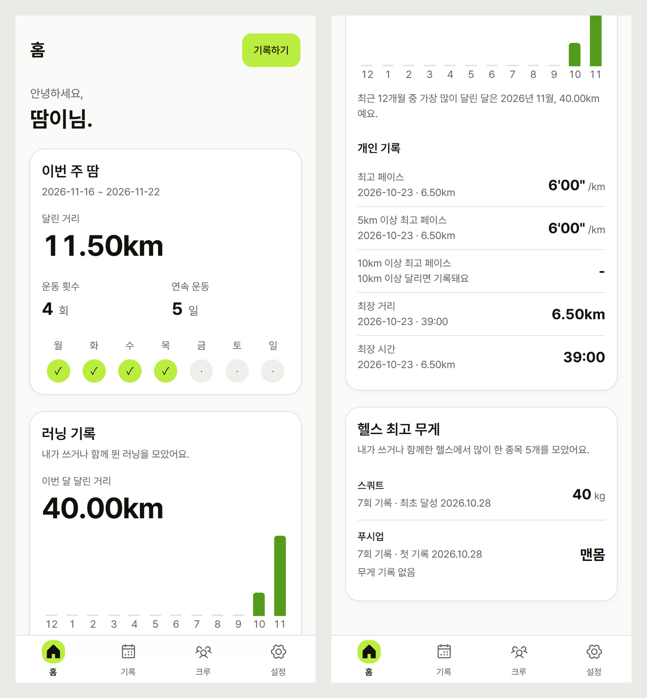
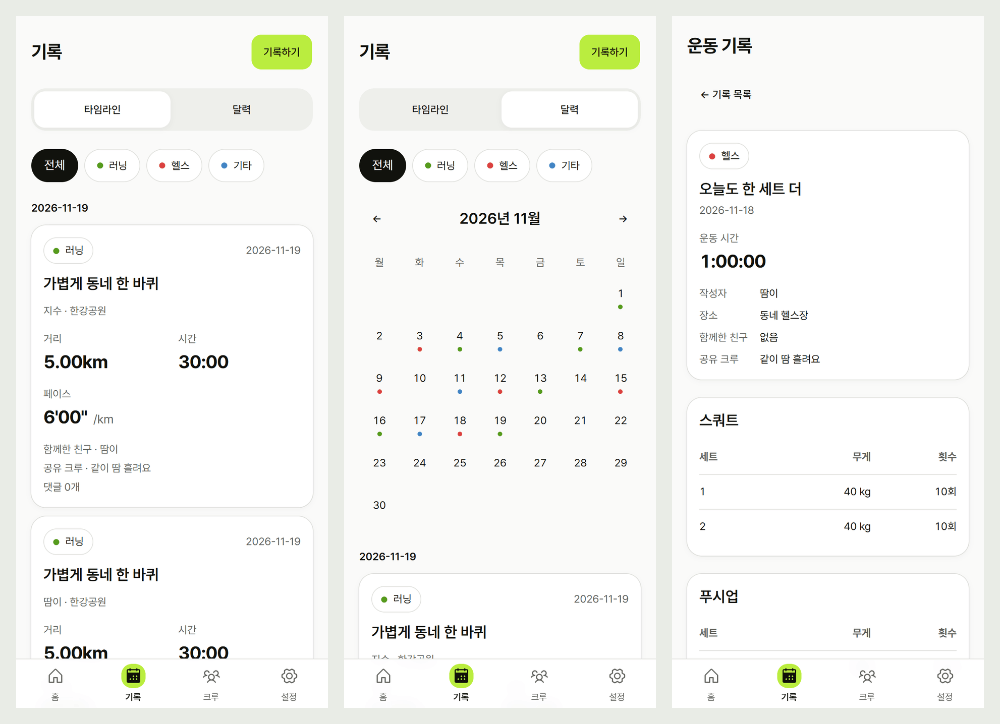
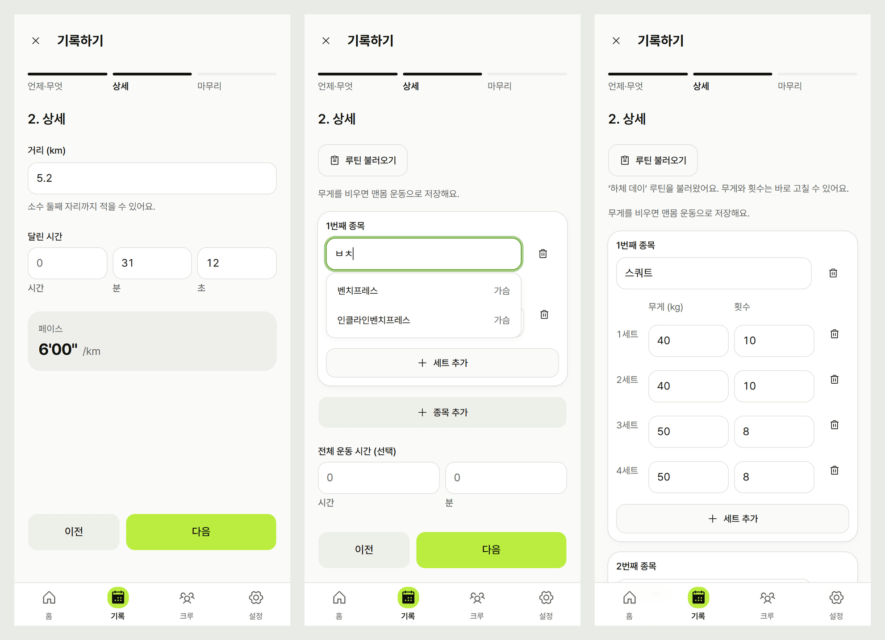
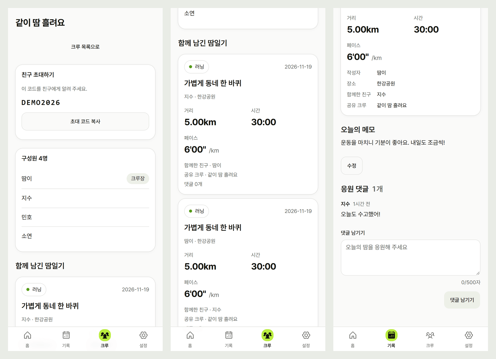

# 땀일기 (sweat-log)

**러닝과 헬스, 크루와 함께 흘린 땀을 기록해요.**

땀일기는 홈 화면에 설치해 앱처럼 쓰는 운동 일기 PWA(Progressive Web App)예요.
러닝은 거리와 시간만 적으면 페이스를 계산해 주고, 헬스는 종목별 세트를 무게 × 횟수로 남겨요.
친구들과 크루로 묶여 서로의 기록을 보고 댓글로 응원할 수 있어요.

[땀일기](https://sweat-log-crew.vercel.app)에서 바로 쓸 수 있고, 가입 없이 [체험 데모](https://sweat-log-crew.vercel.app/demo)에서 샘플 데이터로 주요 기능을 직접 써 볼 수 있어요.

## 홈 화면에 설치해서 사용하기

땀일기는 브라우저에서 바로 쓸 수 있고, 홈 화면에 설치하면 주소창 없이 독립된 앱 화면으로 실행돼요.

- **iPhone**: Safari에서 서비스를 열고 공유 버튼의 ‘홈 화면에 추가’를 선택해요. [Apple 설치 안내](https://support.apple.com/ko-kr/guide/iphone/iph42ab2f3a7/ios)
- **Android·데스크톱**: 지원 브라우저의 ‘앱 설치’ 또는 ‘홈 화면에 추가’ 메뉴를 사용해요. [브라우저별 설치 안내](https://developer.mozilla.org/en-US/docs/Web/Progressive_web_apps/Guides/Installing)
- **알림**: 설정의 ‘알림’에서 ‘알림 켜기’를 누르고 알림 권한을 허용하면 크루에 새 기록이 올라오거나, 친구가 나를 함께한 친구로 넣거나, 내 기록에 댓글이 달릴 때 알림을 받아요. 켠 기기에만 적용되고 로그아웃하면 꺼져요. iPhone·iPad에서는 홈 화면에 추가한 땀일기에서만 알림을 받을 수 있어요.

기록을 보고 저장하려면 인터넷 연결이 필요해요. 연결이 끊기면 오프라인 안내 화면을 보여 줘요.

## 주요 기능

- **러닝·헬스 기록**: 날짜·종류·장소·메모와 함께한 친구, 공유할 크루를 남겨요. 러닝은 거리와 시간을 적으면 페이스를 자동으로 계산하고, 헬스는 종목별 세트를 무게 × 횟수로 적어요. 무게를 비우면 맨몸 운동으로 저장해요.
- **종목 사전과 초성 검색**: 종목 이름을 ‘ㅂㅊ’처럼 초성만 적어도 사전에서 찾아 부위와 함께 추천해요.
- **내 종목**: 사전에 없는 종목은 부위와 맨몸 여부를 골라 내 종목으로 등록하면 다음부터 추천에 떠요. 설정의 ‘내 종목 관리’에서 고치고, 기록에만 있는 종목도 바로 등록해요.
- **헬스 루틴**: 자주 하는 종목과 세트 구성을 루틴으로 저장해 두고 기록할 때 ‘루틴 불러오기’로 채워요. 헬스 기록 상세에서 ‘이 구성으로 루틴 만들기’로 바로 만들 수도 있어요.
- **루틴 갱신 제안**: 루틴을 불러와 운동한 뒤 저장하면 그날 한 내용으로 루틴을 업데이트할지 물어요. 무게가 늘어 가는 걸 루틴이 따라가요.
- **최근 기록 불러오기**: 루틴 없이도 최근 7일 안의 내 헬스 기록을 골라 그 구성 그대로 기록해요.
- **기록 목록과 달력**: 타임라인과 월 달력으로 기록을 돌아보고 러닝·헬스·기타로 걸러 봐요. 달력에는 운동 종류별 색 점이 찍혀요.
- **홈 주간 요약**: 이번 주 달린 거리, 운동 횟수, 연속 운동 일수를 한눈에 봐요.
- **러닝 통계와 헬스 최고 무게**: 최근 12개월 월별 달린 거리, 최고 페이스·최장 거리 같은 개인 기록, 많이 한 종목의 최고 무게를 모아 봐요.
- **크루와 크루 피드**: 크루를 만들고 초대 코드로 친구를 불러요. 크루에 공유된 기록을 한곳에서 모아 봐요.
- **응원 댓글**: 기록마다 댓글로 응원을 주고받아요.
- **사진 첨부**: 기록 하나에 사진을 4장까지 붙여요. 사진도 기록을 볼 수 있는 사람만 봐요.
- **푸시 알림**: 새 기록과 댓글 소식을 기기별로 켜고 끄며 받아요.
- **공개 범위**: 기록은 작성자, 함께한 친구, 공유한 크루의 구성원만 봐요. 수정과 삭제는 작성자만 할 수 있어요.
- **화면 모드**: 라이트·다크·시스템 모드를 지원해요.
- **체험 데모**: 가입 없이 실제 앱 화면과 샘플 데이터로 기록·크루·루틴을 써 봐요. 체험 데이터는 그 브라우저 탭 안에만 저장돼요.

### 개발 예정

지금 정해 둔 개발 예정 기능은 모두 반영했어요. 새로 정한 기능은 이 목록에 체크박스로 더해요.

## 실제 화면

모두 체험 데모에서 찍은 화면이고, 등장하는 사람과 기록은 가상 데이터예요.

### 홈에서 이번 주 돌아보기

이번 주 달린 거리와 연속 운동 일수, 러닝 개인 기록과 헬스 최고 무게를 홈에서 봐요.

[](docs/images/home-flow.png)

### 기록 목록과 달력

타임라인과 달력에서 지난 기록을 찾고, 기록을 열어 세트까지 자세히 봐요.

[](docs/images/records-flow.png)

### 기록 작성: 러닝 페이스, 종목 검색, 루틴 불러오기

러닝은 거리와 시간만 적으면 페이스가 나오고, 헬스는 초성으로 종목을 찾거나 루틴을 불러와 세트를 채워요.

[](docs/images/record-create-flow.png)

### 크루와 응원 댓글

초대 코드로 모인 크루의 기록을 피드에서 보고, 기록에 응원 댓글을 남겨요.

[](docs/images/crew-flow.png)

## 기술 스택

| 영역 | 사용 기술 |
| --- | --- |
| 웹 | Next.js App Router, React, TypeScript |
| 스타일·UI | Tailwind CSS, shadcn/ui, Base UI, Phosphor Icons, Pretendard |
| 서버 상태 | TanStack Query |
| 인증·데이터 | Supabase Auth, PostgreSQL, RLS, Supabase Storage |
| PWA | Web App Manifest, Service Worker, Web Push(web-push) |
| 도구 | pnpm, Biome, Vitest, Testing Library, GitHub Actions |

## 시작하기

```sh
pnpm install
cp .env.example .env.local   # 아래 환경 변수 입력
pnpm db:start                # 로컬 Supabase (Docker 필요)
pnpm dev
```

| 환경 변수 | 설명 |
| --- | --- |
| `NEXT_PUBLIC_SUPABASE_URL`, `NEXT_PUBLIC_SUPABASE_PUBLISHABLE_KEY` | Supabase 주소와 publishable key. 로컬은 `pnpm db:start` 출력값을 써요. |
| `NEXT_PUBLIC_VAPID_PUBLIC_KEY`, `VAPID_PRIVATE_KEY` | 푸시 알림 키. `pnpm exec web-push generate-vapid-keys`로 만들어요. |
| `VAPID_SUBJECT` | 푸시 서비스가 연락할 주소(https URL 또는 `mailto:`) |
| `SUPABASE_SECRET_KEY` | 서버 전용. 알림 받을 사람의 구독을 읽는 데만 써요. 로컬은 `pnpm exec supabase status -o env`의 `SECRET_KEY`예요. |

푸시 알림 값은 비워 둬도 앱은 동작하고, 알림만 빠져요.

## 프로젝트 구조

```text
app/             Next.js 라우팅 진입점, manifest와 앱 아이콘
pages/           Pages Router 충돌 방지용 빈 폴더(README만 있음)
src/app/         전역 스타일, provider, 글꼴, 서비스 워커 등록
src/pages/       페이지 단위 화면 조합
src/widgets/     하단 내비게이션, 기록 작성 폼 등 화면 블록
src/features/    로그인, 기록 작성, 크루, 댓글, 사진, 푸시 알림 등 사용자 행동
src/entities/    운동 기록, 종목, 루틴, 크루, 프로필 등 도메인
src/shared/      공용 UI, API 클라이언트, 유틸
src/demo/        실제 앱 화면과 샘플 데이터를 연결하는 체험 데모
public/          서비스 워커, 오프라인 안내 화면, PWA 아이콘
supabase/        DB 마이그레이션, 권한(RLS) SQL 테스트(tests/)
docs/            개발 가이드, 로드맵, 작업 브리프, README 스크린샷
proxy.ts         요청마다 Supabase 세션 갱신
```

Feature-Sliced Design의 레이어별 의존 방향(`app → pages → widgets → features → entities → shared`)을 따르고, 상세 규칙은 [코드 컨벤션](docs/guides/convention.md)에 정리되어 있어요.

## 개발 문서

- [코드 컨벤션](docs/guides/convention.md)
- [검증 가이드](docs/guides/verification.md)
- [디자인 가이드](docs/guides/design.md)
- [AI 협업 방식](docs/guides/ai-workflow.md)
- [로드맵과 작업 영역](docs/planning/roadmap.md)
- [DB 구조와 권한](supabase/README.md)
